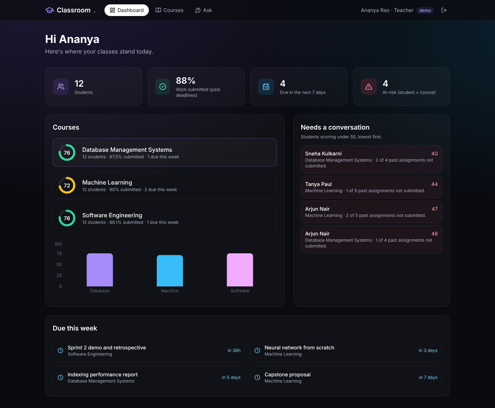
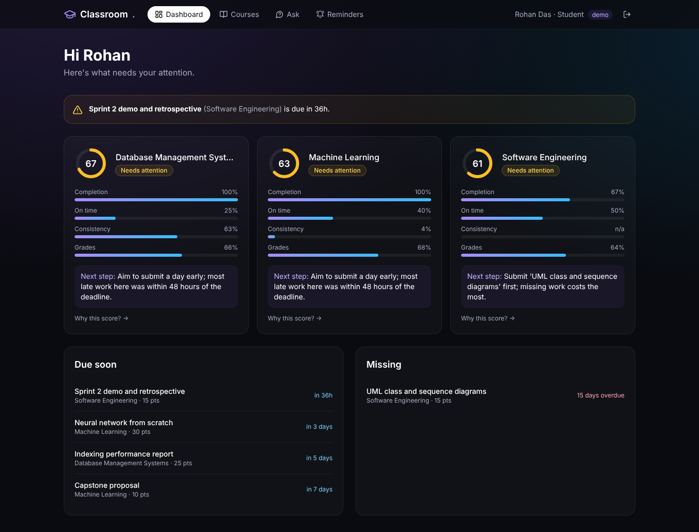
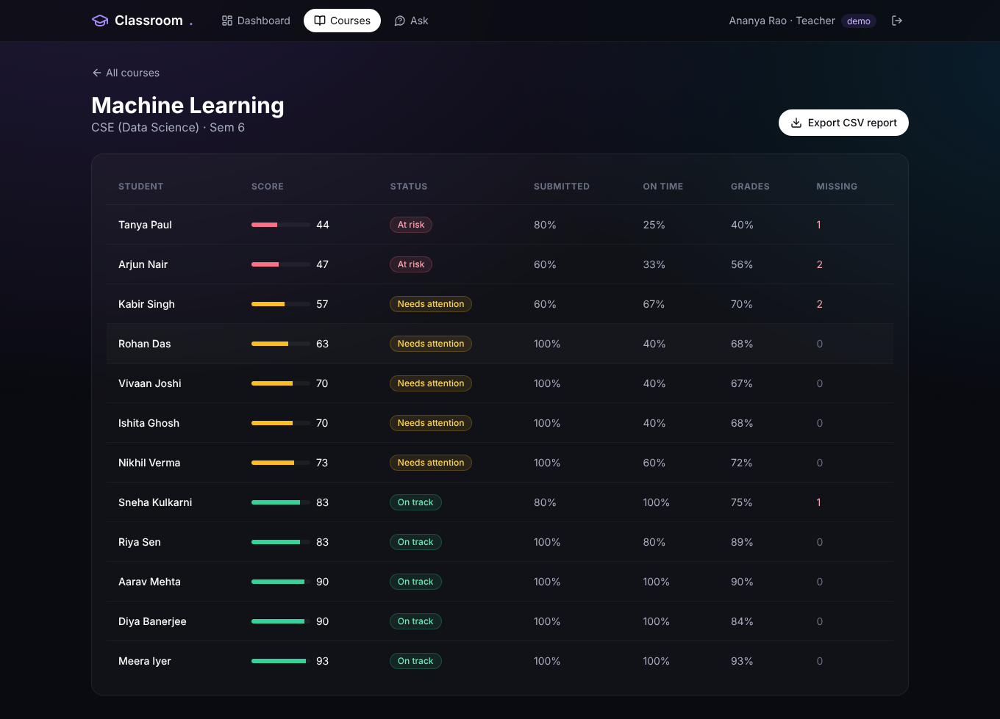
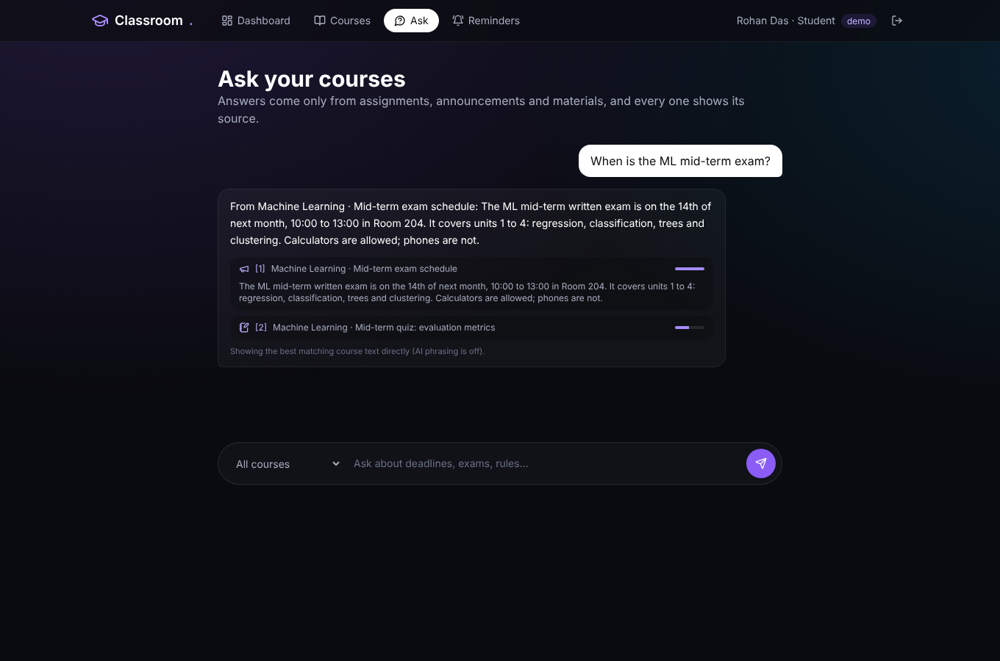
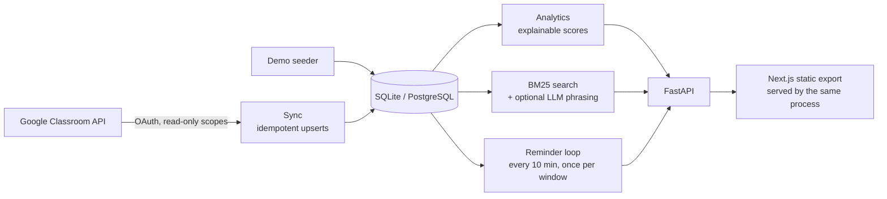

# Classroom Assistant

**Know who's falling behind before the deadline does.**

A companion app for Google Classroom. Teachers see which students are slipping and *why*. Students see what's due, what's missing and the one thing that would help most. Both can ask questions about their courses ("When is the mid-term?") and get answers with the source shown.

**Try it in one click:** the app ships with a demo classroom (12 fictional students, 3 courses, 19 assignments) and *Try as a teacher* / *Try as a student* buttons. No Google account, database server or API key needed.



## Features

**For teachers**
- Dashboard: course averages, submission rate, work due this week, and a ranked "needs a conversation" list.
- Course roster sorted by risk. Open any student to see their score broken down, the reasons, and suggested actions.
- One-click CSV progress report per course.

**For students**
- Per-course progress with a plain-English "next step".
- Due-soon and missing work in one place.
- Reminders at 48h, 24h and 2h before deadlines (configurable). Each fires once, and they stop the moment you submit.

**For everyone**
- *Ask your courses*: answers come only from assignments, announcements and materials, with sources. If nothing relevant exists it says so instead of guessing.

| Student view | Roster | Q&A |
|---|---|---|
|  |  |  |

## How progress is scored

Rules, not a black-box model, so every number can be traced to real submissions:

| Factor | Weight | Measures |
|---|---|---|
| Completion | 35% | Share of assignments **whose deadline has passed** that were submitted |
| On time | 25% | Share of submitted work that was on time |
| Grades | 25% | Points earned / points available on returned work |
| Consistency | 15% | How steady submission timing is relative to each deadline (needs ≥ 3 submissions) |

Factors without data (e.g. nothing graded yet) are left out and the weights re-normalised. Bands: **on track** ≥ 75, **needs attention** ≥ 55, **at risk** below.

## Architecture



- **One process, one container.** The Next.js frontend is a static export served by FastAPI, so the app deploys as a single service on any free tier.
- **Runs anywhere.** SQLite by default, PostgreSQL via `DATABASE_URL` (portable column types only). No Redis, vector database or GPU.
- **Security.** Google refresh tokens are encrypted at rest with Fernet, using a key derived via HKDF-SHA256 from `SECRET_KEY`. The app refuses to start in production without a 32+ character secret. OAuth uses a CSRF `state`, and the session token is handed to the browser in the URL fragment so it never reaches server logs. Students can only read their own data (tested).

## Run it

```bash
git clone https://github.com/Deepansh-Deep/classroom-assistant && cd classroom-assistant

# backend
python -m venv .venv && source .venv/bin/activate          # Windows: .venv\Scripts\activate
pip install -r backend/requirements.txt
# frontend (build once; FastAPI serves the result)
cd frontend && npm ci && npm run build && cd ..

cd backend && uvicorn classroom.api:app --reload
```

Open http://localhost:8000 and click **Try as a teacher**.

Frontend development with hot reload: run the backend as above, then `cd frontend && npm run dev` and open http://localhost:3000.

**Docker:** `docker build -t classroom . && docker run -p 8000:8000 classroom`. With PostgreSQL: `cp .env.example .env` (set `SECRET_KEY`), then `docker compose up`.

### Connecting real Google Classroom

1. In Google Cloud Console, enable the **Google Classroom API** and create an OAuth client ID of type *Web application*.
2. Add `http://localhost:8000/api/auth/google/callback` as an authorised redirect URI.
3. Put `GOOGLE_CLIENT_ID` and `GOOGLE_CLIENT_SECRET` in `.env`. A *Sign in with Google Classroom* button appears on the home page.

Only read-only scopes are requested. Teachers' rosters and submissions are synced; students only sync their own work.

## Tests

```bash
cd backend && pip install -r requirements-dev.txt && pytest -q
```

16 tests cover the scoring rules, role-based access (students can't see rosters or other students), CSV export, Q&A grounding and refusal, reminders firing exactly once, token encryption and secret validation. CI also type-checks and builds the frontend.

## What changed from v1

v1 couldn't be demonstrated: it needed Google OAuth credentials, PostgreSQL, Redis, ChromaDB and a 2 GB PyTorch install before showing a single screen. v2 is a rewrite focused on running anywhere and on correctness:

| v1 | v2 |
|---|---|
| Needed 5 services + Google credentials to start | `uvicorn` and a browser; one-click demo |
| Backend duplicated byte-for-byte in `app/` and `backend/app/` | One codebase |
| Fernet key = secret padded with `"0"` and truncated | HKDF-SHA256 derivation, secret length enforced |
| Dashboard showed hard-coded numbers (`Completed: 12`, `At risk: 2`) | Every number computed from data |
| Future assignments counted as missing | Only past deadlines count |
| "Consistency" measured gaps between submission dates | Measures timing relative to each deadline |
| "Confidence" was cosine similarity shown as certainty | Sources shown with relative relevance; refuses when nothing matches |
| Email/webhook reminders were `TODO`s | Reminder engine with de-duplication and per-user timing |
| No tests | 16 backend tests, CI with type-check and build |

## Limitations

- Reminders are delivered to the in-app list and server log. Plugging in email (SMTP/SendGrid) means implementing the `notify` callback in `reminders.run_cycle`.
- The demo resets every 7 days so its deadlines stay current.
- Google sync runs on sign-in and on *Sync now*, not on a schedule.

## Stack

FastAPI · SQLAlchemy 2 · SQLite/PostgreSQL · Google Classroom API (OAuth 2) · PyJWT · cryptography · Next.js 14 · TypeScript · Tailwind CSS · Recharts · pytest · GitHub Actions · Docker

---
Built by [Deepansh Deep](https://github.com/Deepansh-Deep). Started during the Generative AI training programme at Haldia Institute of Technology (EEGRAB, Jan 2026), and later rebuilt.
